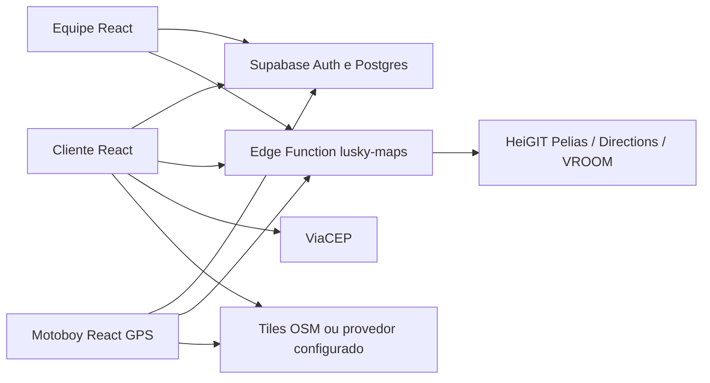

# Arquitetura

O frontend Vite compartilha autenticação e dados com Supabase. `src/CustomerPortal.jsx`, `RiderPortal.jsx`, `OperationsPages.jsx`, `RestaurantSettings.jsx`, `DeliveryAddress.jsx` e `DeliveryMap.jsx` isolam os fluxos novos. `App.jsx` ainda contém componentes antigos e é o ponto de composição e atualização Realtime. `vite.config.js` ativa o runtime JSX do React e separa Supabase do bundle principal; o mapa é carregado sob demanda.

O pedido é criado por `lusky_place_order`: o banco valida itens, disponibilidade, preços, cobertura e idempotência e grava snapshot do endereço. Transições, atribuição, códigos e GPS usam RPCs com autorização no servidor. A Edge Function autenticada mantém a chave HeiGIT fora do navegador; geocodifica, calcula a rota A→B e sugere sequência de 2 a 8 entregas atribuídas ao mesmo motoboy. A geometria A→B é salva em `lusky_order_routes`.

`lusky_orders` e `lusky_driver_locations` estão na publicação Realtime. A interface relê o banco após inscrição e periodicamente no acompanhamento. Posição observada é diferente da rota planejada; o ETA usa vias de perfil `driving-car` sem trânsito. O mapa Leaflet usa tiles com atribuição. O rastreamento requer HTTPS, permissão do navegador e app do motoboy ativo; não há rastreamento confiável em segundo plano com a página fechada.

Limitações atuais: a Central consulta filtros e páginas de 20 pedidos no servidor, mas resumo, clientes e relatórios ainda carregam todos os pedidos em blocos de 500 e calculam agregados no navegador; otimização sugere sequência para um motoboy, sem distribuir entregas entre motoboys; cache e limite de taxa da Edge Function são por instância; notificações são dentro da página, sem push externo.
